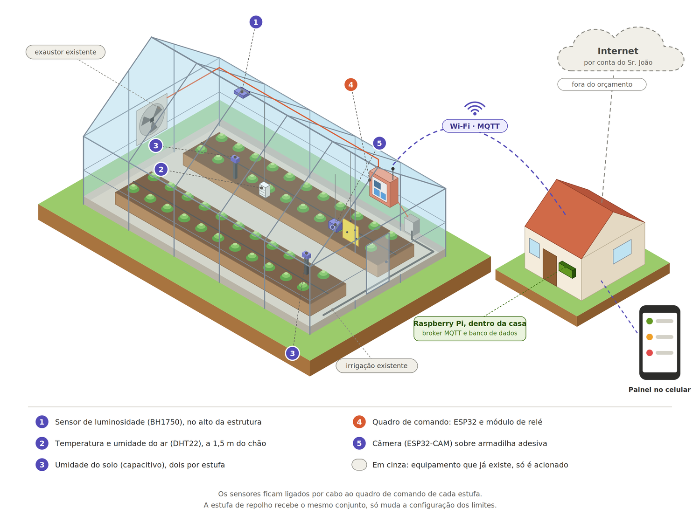
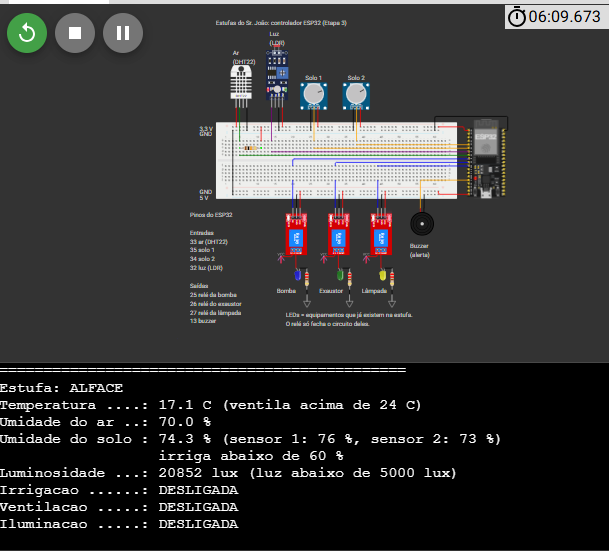
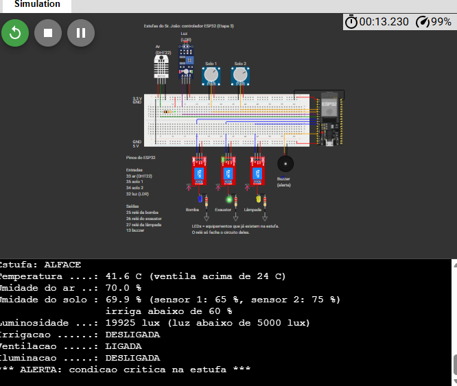
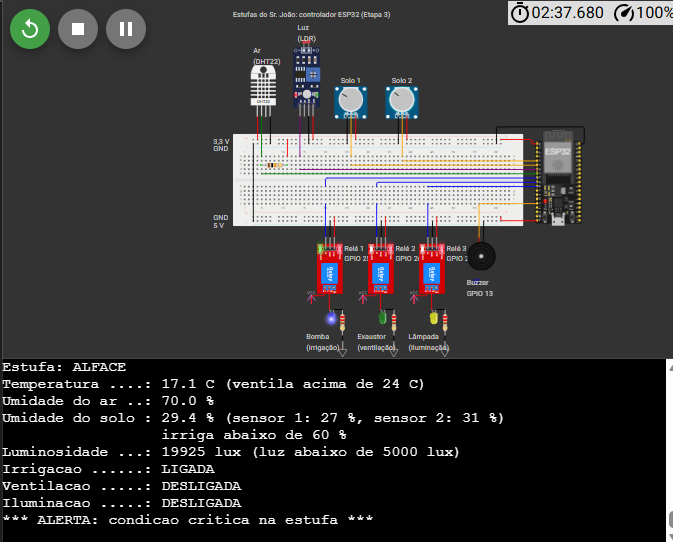
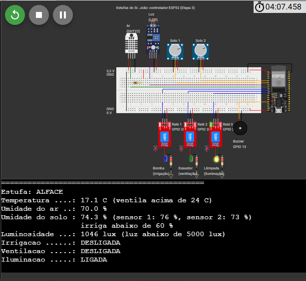
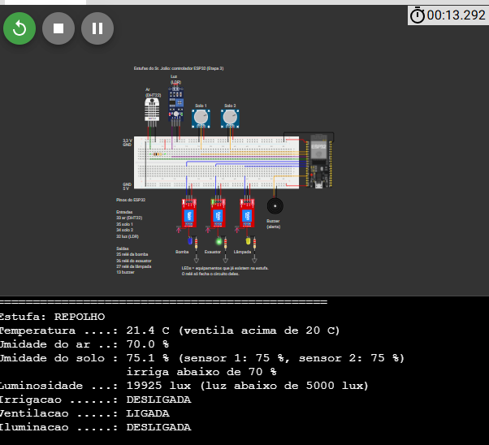

# Estufas IoT - ESP32

Controle automático de duas estufas, uma de alface e outra de repolho, desenvolvido com ESP32 e MicroPython e simulado no Wokwi.
Projeto em grupo da disciplina de Internet das Coisas - Engenharia de Software (UMC), feito por André, Carlos e Kauet.

O desenho mostra o sistema completo. Esta etapa cobre o controlador de cada estufa. O Wi-Fi, o MQTT e o Raspberry Pi entram na próxima.

## Simulação

| Estufa | Projeto no Wokwi |
|---|---|
| Alface | [wokwi.com/projects/477352937216957441](https://wokwi.com/projects/477352937216957441) |
| Repolho | [wokwi.com/projects/477354862781330433](https://wokwi.com/projects/477354862781330433) |

As duas estufas usam o mesmo circuito e o mesmo código. A única diferença é a linha `CULTURA` no `main.py`, que define os limites de cada cultura.

## Funcionalidades

- **Ventilação**: liga o relé do exaustor quando a temperatura passa do limite da cultura
- **Irrigação**: liga o relé da bomba quando a umidade do solo fica abaixo do mínimo (média de dois sensores)
- **Iluminação**: liga o relé da lâmpada quando a luminosidade cai abaixo de 5.000 lux
- **Alerta**: o buzzer toca quando a temperatura passa 5 °C do limite ou o solo fica 15 pontos abaixo do mínimo
- **Monitor serial**: mostra as leituras e o estado de cada relé a cada 2 segundos

Os LEDs ligados nos relés representam a bomba, o exaustor e a lâmpada que já existem na estufa. O ESP32 não liga esses equipamentos direto, só aciona os relés.

## Limites por cultura

| Cultura | Ventilação liga acima de | Irrigação liga abaixo de |
|---|---|---|
| Alface | 24 °C | 60% |
| Repolho | 20 °C | 70% |

Para o relé não ficar ligando e desligando perto do limite, cada saída só desliga depois de uma folga: 1 °C na temperatura, 5 pontos na umidade do solo e 1.000 lux na luz.

## Ligações

| Componente | Pino | Função |
|---|---|---|
| DHT22 | GPIO 33 | Temperatura e umidade do ar (pull-up de 10 kΩ) |
| Potenciômetro Solo 1 | GPIO 35 (ADC1) | Umidade do solo simulada |
| Potenciômetro Solo 2 | GPIO 34 (ADC1) | Umidade do solo simulada |
| Módulo LDR | GPIO 32 (ADC1) | Luminosidade, convertida para lux |
| Relé 1 | GPIO 25 | Irrigação |
| Relé 2 | GPIO 26 | Ventilação |
| Relé 3 | GPIO 27 | Iluminação |
| Buzzer | GPIO 13 (PWM) | Alerta |

Os sensores analógicos ficam no ADC1 porque o ADC2 não funciona com o Wi-Fi ligado. A protoboard distribui 3,3 V para os sensores e 5 V para os relés.

No Wokwi não existem o sensor capacitivo de umidade do solo nem o BH1750, então foram usados potenciômetros e um módulo LDR no lugar deles.

## Testes

### Alface com tudo dentro da faixa

### Calor de 41,6 °C: ventilação e alerta

### Solo seco (29,4%): irrigação e alerta

### Pouca luz (1.046 lux): iluminação

### Repolho a 21,4 °C: ventilação
Na estufa de alface essa temperatura não liga nada, porque o limite lá é 24 °C.

## Como rodar

1. Cria um projeto ESP32 MicroPython no [Wokwi](https://wokwi.com)
2. Substitui o conteúdo do `diagram.json`
3. Substitui o conteúdo do `main.py`
4. Para a estufa de repolho, troca `CULTURA = "alface"` por `CULTURA = "repolho"`
5. Roda a simulação e clica no DHT22, no LDR ou nos potenciômetros para mudar os valores

## Próxima etapa

Conexão Wi-Fi e envio das leituras por MQTT para um painel de acompanhamento.

## Tecnologias

MicroPython · ESP32 · Wokwi
