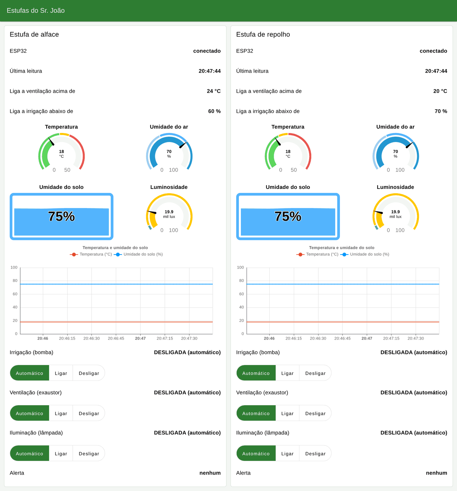
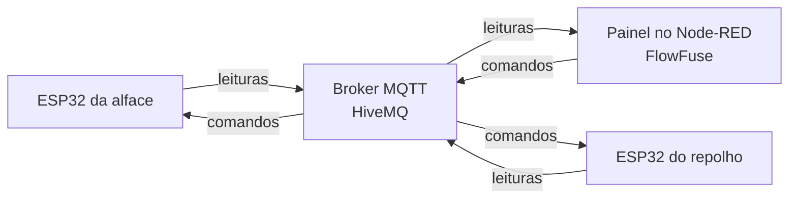

# Estufas IoT - ESP32

Controle automático de duas estufas, uma de alface e outra de repolho, desenvolvido com ESP32 e MicroPython e simulado no Wokwi. Cada estufa se conecta ao Wi-Fi e manda as leituras por MQTT para um painel no Node-RED, de onde também dá para ligar e desligar os equipamentos.
Projeto em grupo da disciplina de Internet das Coisas - Engenharia de Software (UMC), feito por André, Carlos e Kauet.

O desenho mostra a proposta completa para as estufas. No protótipo, o broker é o HiveMQ público e o painel roda no FlowFuse, no lugar do Raspberry Pi.

## Links

| O quê | Link |
|---|---|
| Painel online | [machine-live-display-2026.flowfuse.cloud/dashboard](https://machine-live-display-2026.flowfuse.cloud/dashboard) |
| Estufa de alface no Wokwi | [wokwi.com/projects/477589743138183169](https://wokwi.com/projects/477589743138183169) |
| Estufa de repolho no Wokwi | [wokwi.com/projects/477590498727552001](https://wokwi.com/projects/477590498727552001) |

O painel só recebe dados com as simulações rodando, então dá play nos dois projetos do Wokwi antes de abrir.

As duas estufas usam o mesmo circuito e o mesmo código. A única diferença é a linha `CULTURA` no `main.py`, que define os limites de cada cultura.

## Como funciona

1. O ESP32 lê os sensores a cada 2 segundos e decide sozinho o que ligar
2. Publica as leituras em JSON no broker público do HiveMQ (`broker.hivemq.com`, porta 1883)
3. O painel assina esses tópicos e mostra os medidores, o gráfico e o estado de cada equipamento
4. Os botões do painel mandam comandos de volta pelo mesmo broker

Se a conexão cair, a estufa continua se controlando sozinha e o ESP32 tenta reconectar a cada 10 segundos.

## Tópicos MQTT

Cada estufa usa o prefixo `umc/estufas-ack/<cultura>`, com `alface` ou `repolho` no lugar de `<cultura>`.

| Tópico | Sentido | Conteúdo |
|---|---|---|
| `<prefixo>/telemetria` | ESP32 para o painel | JSON a cada 2 s com as leituras, o estado e o modo de cada relé, o alerta e os limites da cultura |
| `<prefixo>/status` | ESP32 para o painel | `online` (retido) ao conectar e `offline` pelo last will quando a conexão cai |
| `<prefixo>/comando/irrigacao` `<prefixo>/comando/ventilacao` `<prefixo>/comando/iluminacao` | Painel para o ESP32 | `AUTO`, `LIGAR` ou `DESLIGAR` |

O client ID de cada ESP32 é fixo (`umc-estufas-ack-<cultura>`). Assim, quando a simulação reinicia, a conexão nova substitui a antiga no broker e o status não fica preso em `offline`.

## Funcionalidades

- **Ventilação**: liga o relé do exaustor quando a temperatura passa do limite da cultura
- **Irrigação**: liga o relé da bomba quando a umidade do solo fica abaixo do mínimo (média de dois sensores)
- **Iluminação**: liga o relé da lâmpada quando a luminosidade cai abaixo de 5.000 lux
- **Alerta**: o buzzer toca quando a temperatura passa 5 °C do limite ou o solo fica 15 pontos abaixo do mínimo
- **Controle pelo painel**: cada equipamento tem Automático, Ligar e Desligar. Em Ligar ou Desligar, ele fica no manual até alguém clicar em Automático
- **Conexão**: o painel mostra se cada ESP32 está conectado e a hora da última leitura
- **Monitor serial**: mostra as leituras, o estado de cada relé e a conexão MQTT a cada 2 segundos

A umidade do ar só aparece no painel, porque a estufa não tem equipamento para controlar ela.

Os LEDs ligados nos relés representam a bomba, o exaustor e a lâmpada que já existem na estufa. O ESP32 não liga esses equipamentos direto, só aciona os relés.

## Limites por cultura

| Cultura | Ventilação liga acima de | Irrigação liga abaixo de |
|---|---|---|
| Alface | 24 °C | 60% |
| Repolho | 20 °C | 70% |

Para o relé não ficar ligando e desligando perto do limite, cada saída só desliga depois de uma folga: 1 °C na temperatura, 5 pontos na umidade do solo e 1.000 lux na luz. Por exemplo, a ventilação da alface liga acima de 24 °C e só desliga com 23 °C ou menos.

## Ligações

| Componente | Pino | Função |
|---|---|---|
| DHT22 | GPIO 33 | Temperatura e umidade do ar (pull-up de 10 kΩ) |
| Potenciômetro Solo 1 | GPIO 35 (ADC1) | Umidade do solo simulada |
| Potenciômetro Solo 2 | GPIO 34 (ADC1) | Umidade do solo simulada |
| Módulo LDR | GPIO 32 (ADC1) | Luminosidade, convertida para lux |
| Relé 1 | GPIO 25 | Irrigação |
| Relé 2 | GPIO 26 | Ventilação |
| Relé 3 | GPIO 27 | Iluminação |
| Buzzer | GPIO 13 (PWM) | Alerta |

Os sensores analógicos ficam no ADC1 porque o ADC2 não funciona com o Wi-Fi ligado. A protoboard distribui 3,3 V para os sensores e 5 V para os relés.

No Wokwi não existem o sensor capacitivo de umidade do solo nem o BH1750, então foram usados potenciômetros e um módulo LDR no lugar deles.

## Como rodar

### Simulação

1. Abre os dois projetos do Wokwi (links lá em cima) e dá play
2. Espera aparecer `MQTT conectado em broker.hivemq.com` no monitor serial
3. Abre o painel e clica no DHT22, no LDR ou nos potenciômetros para mudar os valores

Para montar do zero, cria um projeto ESP32 MicroPython no [Wokwi](https://wokwi.com), substitui o `diagram.json` e o `main.py` e, na estufa de repolho, troca `CULTURA = "alface"` por `CULTURA = "repolho"`.

### Painel em outro Node-RED

1. Instala o `@flowfuse/node-red-dashboard` pelo gerenciador de paleta
2. Importa o `node-red/fluxo-estufas.json`
3. Faz o deploy e abre `/dashboard`

## Testes pelo painel

| Teste | O que fazer | O que acontece |
|---|---|---|
| Calor | DHT22 da alface em 30 °C | A ventilação liga no automático e o alerta dispara, porque passou de 29 °C |
| Controle manual | Desligar na ventilação da alface | A ventilação desliga e o painel mostra "manual". Em Automático, ela volta a ligar |
| Terra seca | Potenciômetros do repolho em uns 60% | A irrigação liga. Ela só desliga com 75% ou mais |
| Pouca luz | LDR da alface em 1.000 lux | A iluminação liga. Ela só apaga com 6.000 lux ou mais |
| Queda do ESP32 | Parar a simulação do repolho | O painel mostra "desconectado" em até uns 45 s. No play, reconecta sozinho |

## Testes do controle local (etapa 3)

Prints do monitor serial da etapa anterior, antes do Wi-Fi. A lógica de controle continua a mesma.

### Alface com tudo dentro da faixa

### Calor de 41,6 °C: ventilação e alerta

### Solo seco (29,4%): irrigação e alerta

### Pouca luz (1.046 lux): iluminação

### Repolho a 21,4 °C: ventilação
Na estufa de alface essa temperatura não liga nada, porque o limite lá é 24 °C.

## Tecnologias

MicroPython · ESP32 · Wokwi · MQTT (HiveMQ) · Node-RED Dashboard 2.0 · FlowFuse
